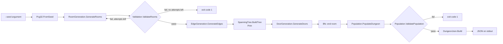
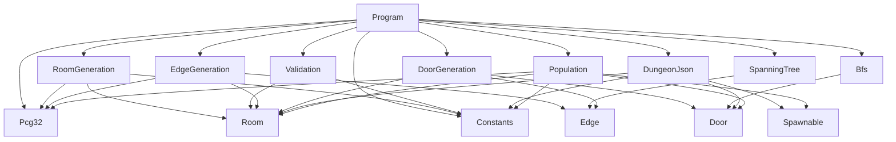

# Architecture

[← Documentation home](README.md)

## Goal

The C# generator produces the same validated dungeon data as the Rust generator, in the same JSON format, so the Godot game can use either one and the two languages can be compared fairly.

```
C# generator → validated dungeon data → JSON → Godot
```

The requirements, concepts (room, door, corridor, backbone, dungeon) and the planned pipeline are the same as for the Rust generator: see [Rust → Architecture](../../../rust/procgen_dungeon/docs/architecture.md).

## Porting approach

The port is built **class by class, in the same order as the Rust generator was built**:

| # | Rust (commit) | C# | Status |
|---|---|---|---|
| 1 | seeded `Pcg32` (36063ae) | [`Pcg32.cs`](../procgen-csharp/Pcg32.cs) | ✅ |
| 2 | `Room` + `generate_rooms` (36063ae, 7cd5a1c) | [`Room.cs`](../procgen-csharp/Room.cs), [`RoomGeneration.cs`](../procgen-csharp/RoomGeneration.cs) | ✅ |
| 3 | `validate_rooms` + retry loop (8415a9d, 71e3fd3) | [`Validation.cs`](../procgen-csharp/Validation.cs), [`Program.cs`](../procgen-csharp/Program.cs) | ✅ |
| 4 | `generate_edges` (c4279d3) | [`Edge.cs`](../procgen-csharp/Edge.cs), [`EdgeGeneration.cs`](../procgen-csharp/EdgeGeneration.cs) | ✅ |
| 5 | `build_tree` / Prim (c4279d3) | [`SpanningTree.cs`](../procgen-csharp/SpanningTree.cs) | ✅ |
| 6 | doors (b04f021) | [`Door.cs`](../procgen-csharp/Door.cs), [`DoorGeneration.cs`](../procgen-csharp/DoorGeneration.cs) | ✅ |
| 7 | JSON export (997fb86) | [`DungeonJson.cs`](../procgen-csharp/DungeonJson.cs) | ✅ |
| 8 | BFS end room (4d0fb94) | [`Bfs.cs`](../procgen-csharp/Bfs.cs) | ✅ (together with 7: the JSON needs the end room) |
| 9 | population + validation (5eeafce) | [`Population.cs`](../procgen-csharp/Population.cs), [`Spawnable.cs`](../procgen-csharp/Spawnable.cs) | ✅ |
| 10 | `stats` (added to Rust and C# together) | [`GenerationStats.cs`](../procgen-csharp/GenerationStats.cs), [`Program.cs`](../procgen-csharp/Program.cs) | ✅ |
| — | corridors | | ❌ cut from scope (e3dc311) |

After each step, the C# output is compared with the Rust output for the same seeds (see [Verification](verification.md)). A step is only done when the output is identical.

The one rule that makes this work: **the random calls must happen in exactly the same order as in Rust.** Every random number depends on all the numbers drawn before it, so one extra, missing or reordered call changes everything after it.

## Pipeline

### Implemented



### Planned

Same as Rust: rooms → validate → edges → Prim backbone → doors → BFS end room → JSON on stdout. Population and stats were added the same way; corridors were cut from scope.

## Data flow in `Program`

| Step | Call | Produces | Code |
|---|---|---|---|
| 1 | parse `--seed` | `seed: ulong`, or exit 2 | [L7–11](../procgen-csharp/Program.cs#L7-L11) |
| 2 | `Pcg32.FromSeed(seed)` | `rng: Pcg32` | [L13](../procgen-csharp/Program.cs#L13) |
| 3 | `GenerateRooms` in a retry loop with `ValidateRooms` | `rooms: List<Room>` | [L18–28](../procgen-csharp/Program.cs#L18-L28) |
| 4 | still invalid after all attempts | exit 1 | [L30–34](../procgen-csharp/Program.cs#L30-L34) |
| 5 | print rooms | stderr | [L36–40](../procgen-csharp/Program.cs#L36-L40) |
| 6 | `EdgeGeneration.GenerateEdges(rng, rooms)` | `edges: List<Edge>` (complete graph) | [L42–50](../procgen-csharp/Program.cs#L42-L50) |
| 7 | `SpanningTree.BuildTree(edges, rooms.Count)` | `tree: List<Edge>` (n − 1 edges) | [L52–60](../procgen-csharp/Program.cs#L52-L60) |
| 8 | `DoorGeneration.GenerateDoors(tree, rooms)` | `doors: List<Door>` (one per tree edge) | [L62–69](../procgen-csharp/Program.cs#L62-L69) |
| 9 | `Bfs.RoomDistances` + `Bfs.FurthestRoom` | `startRoom = 0`, `endRoom` | [L71–77](../procgen-csharp/Program.cs#L71-L77) |
| 10 | `Population.PopulateDungeon(rng, rooms, doors, start, end)` | room kinds, `spawnables` | [L79–86](../procgen-csharp/Program.cs#L79-L86) |
| 11 | `Population.ValidatePopulation(...)` | exit 1 if invalid | [L88–96](../procgen-csharp/Program.cs#L88-L96) |
| 12 | `new GenerationStats { ... }` + `DungeonJson.Build(...)` | JSON with `stats` on stdout | [L98–109](../procgen-csharp/Program.cs#L98-L109) |

The same `rng` object is passed to every random step. C# classes are reference types, so passing `rng` to a method is the same as Rust's `&mut rng`: the method advances the one shared generator.

## Classes

| Class | Responsibility | Public items | Rust equivalent |
|---|---|---|---|
| [`Constants`](../procgen-csharp/Constants.cs) | tunable parameters | all constants | `constants.rs` |
| [`Pcg32`](../procgen-csharp/Pcg32.cs) | seeded RNG | `FromSeed`, `NextU32`, `RandomRange`, `FromStateAndStream` | `rand_pcg::Pcg32` + `rand` (external crates) |
| [`Room`](../procgen-csharp/Room.cs) | room data type | `Id`, `X`, `Y`, `Width`, `Height`, `Overlaps` | `room.rs` |
| [`RoomGeneration`](../procgen-csharp/RoomGeneration.cs) | placing rooms | `GenerateRooms` (`GenerateRoom` is private) | `room_generation.rs` |
| [`Validation`](../procgen-csharp/Validation.cs) | checking a room set | `ValidateRooms` | `validation.rs` |
| [`Edge`](../procgen-csharp/Edge.cs) | candidate connection | `Weight`, `RoomA`, `RoomB` | `Edge` in `edge.rs` |
| [`EdgeGeneration`](../procgen-csharp/EdgeGeneration.cs) | complete graph | `GenerateEdges`, `MinWeight`, `MaxWeight` | `generate_edges` in `edge.rs` |
| [`SpanningTree`](../procgen-csharp/SpanningTree.cs) | backbone | `BuildTree` | `build_tree` in `tree.rs` |
| [`Wall`, `Door`](../procgen-csharp/Door.cs) | door data type | `RoomA`, `RoomB`, `WallA`, `WallB` | `Wall`, `Door` in `door.rs` |
| [`DoorGeneration`](../procgen-csharp/DoorGeneration.cs) | wall per door | `GenerateDoors`, `EdgeToDoor`, `OppositeWall` | `generate_doors`, `edge_to_door`, `opposite_wall` in `door.rs` |
| [`Bfs`](../procgen-csharp/Bfs.cs) | end room | `RoomDistances`, `FurthestRoom` | `room_distances`, `furthest_room` in `bfs.rs` |
| [`Spawnable` records](../procgen-csharp/Spawnable.cs) | spawnable data types | `X`, `Y`, `IsHostile` + fields per kind | `Spawnable` enum in `population.rs` |
| [`Population`](../procgen-csharp/Population.cs) | room kinds, spawning, validation | `PopulateDungeon`, `ChooseRoomKinds`, `EnemyCount`, `DoorTile`, `ValidatePopulation` | `population.rs` |
| [`DungeonJson`](../procgen-csharp/DungeonJson.cs) | JSON output | `Build`, `GeneratorName` | `build_dungeon_json` in `dungeon_json.rs` |
| `Program` (top-level statements) | entry point and pipeline | | `main.rs` |

Each file has one responsibility, like the Rust modules. `RoomGeneration` and `Validation` are `static` classes because they hold no state, the same as free functions in Rust.

The one class with no Rust file of its own is `Pcg32`: Rust gets its RNG from the `rand` and `rand_pcg` crates, while the C# version has to contain it, because `System.Random` produces different numbers. See [Random number generator](rng.md).

## Class dependencies



`Room`, `Edge`, `Door`, `Pcg32` and `Constants` depend on nothing. Dependencies only point "down", so there are no cycles.

## Core data type

[`Room`](../procgen-csharp/Room.cs#L4-L10):

```csharp
public class Room
{
    public int Id { get; set; }
    public int X { get; init; }
    public int Y { get; init; }
    public int Width { get; init; }
    public int Height { get; init; }
}
```

Position and size can only be set when the room is created (`init`), because they never change afterwards. `Id` has a normal setter because it is assigned when the room is accepted ([`RoomGeneration.cs` L23](../procgen-csharp/RoomGeneration.cs#L23)). `Id` equals the room's index in the list, same as in Rust.

## Complexity (n = number of rooms, max 20)

| Method | Cost | At n = 20 |
|---|---|---|
| [`GenerateRooms`](../procgen-csharp/RoomGeneration.cs#L7-L30) | O(attempts · n) | ≤ 1000 × 20 overlap checks |
| [`ValidateRooms`](../procgen-csharp/Validation.cs#L7-L37) | O(n²) | 190 pair checks |
| [`GenerateEdges`](../procgen-csharp/EdgeGeneration.cs#L10-L27) | O(n²) | 190 edges |
| [`BuildTree`](../procgen-csharp/SpanningTree.cs#L8-L40) | O(n · E) = O(n³) on a complete graph | 19 × 190 ≈ 3600 edge checks |
| [`GenerateDoors`](../procgen-csharp/DoorGeneration.cs#L6-L9) | O(n) | 19 doors |
| [`RoomDistances`](../procgen-csharp/Bfs.cs#L7-L40) | O(n) on a tree | 20 rooms, 19 doors |
| [`PopulateDungeon`](../procgen-csharp/Population.cs#L23-L75) | O(tiles · doors) per room | ≤ 18 × 18 inside tiles per room |
| [`ValidatePopulation`](../procgen-csharp/Population.cs#L133-L175) | O(n · spawnables) | 20 rooms × ~25 spawnables |

Same as the Rust version, since the algorithm is the same.
