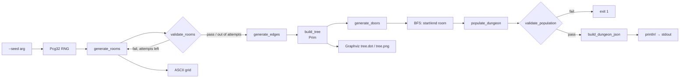
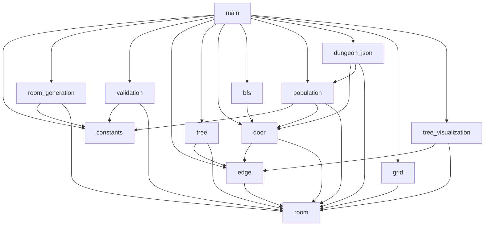

# Architecture

[← Documentation home](README.md)

## Goal

The generator produces validated dungeon data that the Godot game loads as JSON. It has to run and be testable **without Godot**.

```
Rust generator → validated dungeon data → JSON → Godot
```

The Rust side owns generation, validation and the dungeon data. The Godot side owns gameplay, rendering and turning tile coordinates into world positions.

## Requirements

From the brainstorm document.

### The generator must

| Requirement | Status |
|---|---|
| Generate N non-overlapping rooms | ✅ [`room_generation.rs`](../src/room_generation.rs), [`validation.rs`](../src/validation.rs) |
| Create a connected dungeon structure | ✅ [`tree.rs`](../src/tree.rs) (spanning tree), [`door.rs`](../src/door.rs) (doors from the tree) |
| Generate corridors between connected rooms | ❌ cut — dropped from scope to make the deadline, see [Design decisions → Corridors](design-decisions.md#corridors) |
| Populate the dungeon | ✅ [`population.rs`](../src/population.rs) |
| Validate each generation stage | 🟡 rooms and population done, backbone validation still planned |
| Use a seed | ✅ `--seed <int>` CLI arg ([`parse_seed_arg`, `main.rs` L32–46](../src/main.rs#L32-L46)) |
| Export the result for Godot | ✅ JSON printed to stdout ([`dungeon_json.rs`](../src/dungeon_json.rs)) |

### The generator does not initially need

- infinite generation
- chunk streaming
- multithreading
- complex room templates
- advanced optimisation

These are deliberately out of scope for the MVP (see [Roadmap](roadmap.md#scope)).

## Concepts

| Concept | Meaning |
|---|---|
| **Room** | a normal gameplay chamber; one room = one screen |
| **Door / connection** | a normal graph edge; moves the player directly from one room to another |
| **Corridor** | ❌ cut from scope (deadline) — was planned as an optional hidden path between rooms not directly connected in the normal graph; `corridors` stays an empty array in the JSON |
| **Backbone** | the spanning tree of doors; the dungeon must be fully playable with only these |
| **Dungeon** | all rooms plus the graph; it knows which room is the start and which is the end |

## Pipeline

**Corridors are cut from scope** (deadline) — there is no corridor stage below, and `corridors` is always an empty array in the exported JSON.



### Still planned

- Backbone validation (every room reachable, exactly `n − 1` edges) — not written yet.
- Unit tests.

## Data flow in `main`

| Step | Call | Produces | Code |
|---|---|---|---|
| 1 | `parse_seed_arg(&args)`, `Pcg32::seed_from_u64` | `rng: Pcg32` | [`main.rs` L32–58](../src/main.rs#L32-L58) |
| 2 | `generate_rooms` in a retry loop with `validate_rooms` | `rooms: Vec<Room>` | [`main.rs` L60–74](../src/main.rs#L60-L74) |
| 3 | `generate_edges(&mut rng, &rooms)` | `edges: Vec<Edge>` (complete graph) | [`main.rs` L76](../src/main.rs#L76) |
| 4 | `Grid::constructor` + `draw_room` + `print_grid` (stderr) | ASCII map | [`main.rs` L87–91](../src/main.rs#L87-L91) |
| 5 | `build_tree(&edges, &rooms)` | `tree: Vec<Edge>` (n − 1 edges) | [`main.rs` L92](../src/main.rs#L92) |
| 6 | `generate_doors(&tree, &rooms)` | `doors: Vec<Door>` | [`main.rs` L93](../src/main.rs#L93) |
| 7 | `room_distances` + `furthest_room` | `start_room`, `end_room` | [`main.rs` L99–106](../src/main.rs#L99-L106) |
| 8 | `populate_dungeon(&mut rng, &rooms, &doors, start_room, end_room)` | `room_kinds`, `spawnables: Vec<Spawnable>` | [`main.rs` L108–109](../src/main.rs#L108-L109) |
| 9 | `validate_population(...)`, exit `1` on failure | — | [`main.rs` L114–117](../src/main.rs#L114-L117) |
| 10 | `build_dungeon_json(...)`, `println!` to stdout | the JSON string | [`main.rs` L119–120](../src/main.rs#L119-L120) |
| — | `visualize_tree_in_graph_form(&tree, &rooms)` | `tree.dot`, `tree.png` | [`main.rs` L92](../src/main.rs#L92) |

The same `rng` is passed by `&mut` through every random step. That is what makes a seed fully determine the dungeon: the order of calls fixes the order of random numbers. Adding a new random call somewhere in the middle changes everything after it, so the same seed will give a different dungeon after such a change.

## Modules

| Module | Responsibility | Public items |
|---|---|---|
| [`constants`](../src/constants.rs) | tunable parameters | all constants |
| [`room`](../src/room.rs) | the room data type | `Room`, `Room::room_overlap_check` |
| [`room_generation`](../src/room_generation.rs) | placing rooms on the map | `generate_rooms` (`generate_room` is private) |
| [`validation`](../src/validation.rs) | checking a room set | `validate_rooms` |
| [`edge`](../src/edge.rs) | candidate connections between rooms | `Edge`, `generate_edges` |
| [`tree`](../src/tree.rs) | the backbone (spanning tree) | `build_tree` |
| [`door`](../src/door.rs) | doors derived from the backbone | `Door`, `Wall`, `generate_doors` |
| [`bfs`](../src/bfs.rs) | start/end room | `room_distances`, `furthest_room` |
| [`population`](../src/population.rs) | spawning enemies and pickups | `RoomKind`, `Spawnable`, `populate_dungeon`, `validate_population` |
| [`dungeon_json`](../src/dungeon_json.rs) | the exported JSON shape | `DungeonJson`, `build_dungeon_json` |
| [`grid`](../src/grid.rs) | ASCII debug view | `Grid`, `print_grid` |
| [`tree_visualization`](../src/tree_visualization.rs) | Graphviz debug view | `visualize_tree_in_graph_form` |

Each file has one responsibility, so a stage can be tested or replaced on its own. Modules are registered at the top of [`main.rs`](../src/main.rs).

## Module dependencies



`room` and `constants` depend on nothing, and nothing depends on `main`. Dependencies only point "down", so there are no cycles between modules.

## Core data types

[`Room`](../src/room.rs#L1-L8):

```rust
pub struct Room {
    pub width: i32,
    pub height: i32,
    pub x: i32,
    pub y: i32,
    pub id: usize,
}
```

[`Edge`](../src/edge.rs#L6-L11):

```rust
pub struct Edge {
    pub weight: i32,
    pub Ivertex1: usize,
    pub Ivertex2: usize,
}
```

`x` and `y` are the top-left corner, in tiles. `id` is the room's index in the rooms `Vec`, and `Ivertex1` / `Ivertex2` are room ids. Because `id` equals the index, an edge can look up its rooms with `rooms[id]` directly. This only holds as long as rooms are never removed or reordered after generation.

## Complexity (n = number of rooms, max 20)

| Function | Cost | At n = 20 |
|---|---|---|
| [`generate_rooms`](../src/room_generation.rs#L24-L47) | O(attempts · n) | ≤ 1000 × 20 overlap checks |
| [`validate_rooms`](../src/validation.rs#L4-L32) | O(n²) | 190 pair checks |
| [`generate_edges`](../src/edge.rs#L12-L25) | O(n²) | 190 edges |
| [`build_tree`](../src/tree.rs#L4-L29) | O(n · E) = O(n³) on a complete graph | 19 × 190 ≈ 3600 edge checks |

All are trivial at this size. `build_tree` is the one that would need a priority queue if room counts grow a lot.
