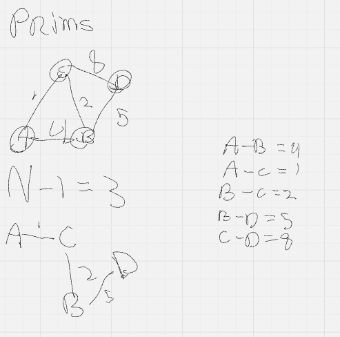
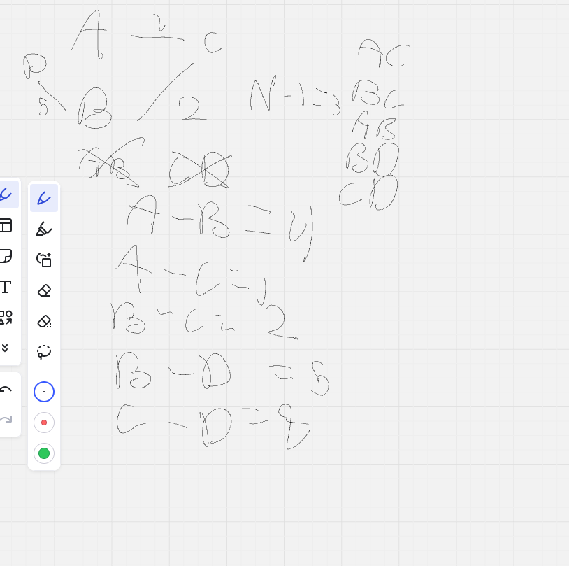

# Design decisions

[← Documentation home](README.md)

Every decision with the options that were considered and the reason for the choice. Most of this comes from the brainstorm document; where a decision changed later, both the original idea and the change are shown.

Legend: ✅ decided · 🔄 changed from the brainstorm · ❓ open

## Contents

- [Game structure](#game-structure)
- [Room design: what kind of room is it?](#room-design-what-kind-of-room-is-it)
- [Determinism](#determinism)
- [Room placement](#room-placement)
- [Candidate edges and weights](#candidate-edges-and-weights)
- [Spanning tree algorithm: Prim vs Kruskal](#spanning-tree-algorithm-prim-vs-kruskal)
- [Tie-breaking](#tie-breaking)
- [Graph representation](#graph-representation)
- [Start and end room](#start-and-end-room)
- [Doors](#doors)
- [Corridors](#corridors)
- [Locked doors and keys](#locked-doors-and-keys)
- [Scope](#scope)

## Game structure

| | Decision |
|---|---|
| ✅ | **One room = one screen.** A door loads the next room immediately; there are no hallways between rooms. |
| ✅ | **No minimap.** |
| ❓ | Still to confirm with the Godot side. |

**Why:** this is how *The Binding of Isaac* works, and it means the generator doesn't need to generate or validate walkable hallways. It also changes how edges are weighted (see below): the player never walks between rooms, so the physical distance between them doesn't matter.

## Room design: what kind of room is it?

Two options from the brainstorm:

**Option 1: rooms know their type**

```
Room {
  id: 1, x: 10, y: 21, width: 12, height: 14,
  room_type: starter
}
```

**Option 2: rooms don't know; only the dungeon knows**

```
Dungeon {
  rooms: [ Room { id: 2, x: 10, y: 12, width: 12, height: 21 } ],
  start: 2
}
```

| | Decision |
|---|---|
| ✅ | **Option 2.** Rooms are generic. The dungeon tracks which room is the start and which is the end. |

**Why:** the spawnables that end up in a room decide what kind of room it is. That adds to the randomness the game is aiming for. In the code, [`Room`](../src/room.rs#L1-L8) has no type field.

## Determinism

| | Decision |
|---|---|
| ✅ | One seeded RNG (`Pcg32`) for the whole pipeline ([`main.rs` L29–30](../src/main.rs#L29-L30)). |
| ✅ | Rooms and edges are stored in `Vec`, never in `HashMap`. |

**Why:** the same seed must always give the same dungeon, for debugging, testing and sharing seeds. A Rust `HashMap` iterates in a different order every run, so if rooms or edges were in a `HashMap`, ties could be broken differently and the same seed could give a different dungeon. A `Vec` always keeps the same order.

## Room placement

| | Decision |
|---|---|
| ✅ | Random size, then random position that fits on the map ([`generate_room`](../src/room_generation.rs#L11-L22)). |
| ✅ | Rejection sampling: overlapping rooms are discarded ([`generate_rooms`](../src/room_generation.rs#L34-L36)). |
| ✅ | **Touching rooms are allowed**, overlap is not ([`room_overlap_check`](../src/room.rs#L17-L20)). |
| ✅ | `id` = index in the rooms `Vec` ([L40](../src/room_generation.rs#L40)). |
| ✅ | Tile-based coordinates; Godot translates tiles to world positions. |

**Why:** rejection sampling is simple and fast enough for at most 20 rooms on a 100×100 map. Touching rooms are still two separate rooms. Using the index as the id means edges can find their rooms with `rooms[id]`.

## Candidate edges and weights

| | Decision |
|---|---|
| 🔄 | Brainstorm: *"Should rooms mostly connect to physically nearby rooms? Yes."* |
| ✅ | Changed to: **every pair of rooms is a candidate edge** (complete graph) with **random weights** ([`generate_edges`](../src/edge.rs#L12-L25)). |

**Why it changed:** with one room per screen, the player never walks the distance between two rooms, so distance-based weights add nothing for gameplay. Random weights (from the seed) make Prim produce a random spanning tree, which gives more variety between seeds. And since any two rooms could share a door, every pair is a valid candidate.

## Spanning tree algorithm: Prim vs Kruskal

The brainstorm question *"how do you stop every room connecting to every other room?"* is answered by a **spanning tree**: it connects all rooms with only `n − 1` edges. Both Prim and Kruskal were researched and worked out by hand on the same graph:

| Edge | A–B | A–C | B–C | B–D | C–D |
|---|---|---|---|---|---|
| Weight | 4 | 1 | 2 | 5 | 8 |

**Prim (by hand), starting from A:**



From A: edges 1 and 4 → take A–C (1). From the visited rooms: B–C (2) is cheapest → take it. Then B–D (5); A–B would make a cycle and C–D (8) is more expensive. Result: A–C, B–C, B–D.

**Kruskal (by hand):**



Sorted: A–C 1, B–C 2, A–B 4, B–D 5, C–D 8. Take A–C, take B–C, skip A–B (cycle), take B–D, stop (n − 1 = 3 edges). Result: A–C, B–C, B–D.

Both give the same tree here because all weights are different. With equal weights, the two algorithms can pick differently.

| | Decision |
|---|---|
| ✅ | **Prim** ([`build_tree`](../src/tree.rs#L4-L29)). |
| ❌ | Kruskal: considered and rejected. |

**Why Prim:**

- it makes more sense and is easier to explain and defend,
- it grows outward from a start room, which matches how a dungeon is explored,
- it works naturally with neighbouring rooms (fits the adjacency list),
- Kruskal needs **Union-Find** to detect cycles efficiently; with limited time, researching that was a deliberate no.

In the code, Prim needs no separate cycle check: an edge is only a candidate if exactly one end is visited ([`tree.rs` L13](../src/tree.rs#L13)), so an edge between two visited rooms (which would close a cycle) is never picked. See [Graph → Why XOR](graph.md#why-xor).

## Tie-breaking

What if two candidate edges have the same weight? Whatever the rule, it must give the same result every run.

Options from the brainstorm:

1. a fixed rule, e.g. lowest room id first,
2. randomly via the seed.

| | Decision |
|---|---|
| 🔄 | Brainstorm: **via the seed**, for more variety while staying deterministic. |
| ✅ | Code: the **first edge in `Vec` order** wins (`<` in [`tree.rs` L14](../src/tree.rs#L14)). |

**Why this is still fine:** the weights themselves are random from the seed, so which edges tie is already seed-driven. The fixed part is only *which* of two equal edges wins, and because the edge `Vec` is always built in the same order, it's deterministic. Whether to add an explicit seed-based tie-break is listed in the [open questions](roadmap.md#open-questions).

## Graph representation

Three options researched:

| Representation | Idea | Good for | Bad for |
|---|---|---|---|
| Adjacency matrix | n × n table, cell = edge or not | "is A connected to B?" instantly | wastes space on a sparse graph |
| Edge set / edge list | list of (A, B, weight) | Kruskal, storing all candidates | "who are B's neighbours?" means scanning everything |
| Adjacency list | per room, a list of neighbours | direct access to neighbours | "is A connected to B?" needs a scan of A's list |

| | Decision |
|---|---|
| ✅ | **Edge list** for candidate edges and Prim input ([`Edge`](../src/edge.rs#L6-L11)). |
| ✅ | **Adjacency list** for the final dungeon graph (planned). |

**Why:** the dungeon graph is **sparse** (many rooms, few doors: a tree has only `n − 1` edges). Validation, BFS and door placement keep asking *"which rooms are next to this room?"*, which the adjacency list answers directly. See [Theory → Graph representations](theory.md#graph-representations).

## Start and end room

| | Decision |
|---|---|
| 🔄 | Brainstorm: start = longest distance from the end; end = longest distance from the start. That's circular: each depends on the other. |
| ✅ | **Start = room 0** (the first room, the spawn room). |
| ✅ | **End = the room furthest from the start** by BFS distance, i.e. the most doors away. (planned) |

**Why:** fixing the start breaks the circular definition. Room 0 is also where Prim starts ([`tree.rs` L6](../src/tree.rs#L6)). BFS distance counts doors, which is what the player experiences; physical distance doesn't matter with one room per screen.

## Doors

| | Decision |
|---|---|
| ✅ | Every edge in the backbone becomes a door. |
| ✅ | **Door directions must be consistent:** leave through room A's right door, come back through room B's left door → you're back in room A. |
| ✅ | **The door wall is derived from where the rooms are relative to each other.** If room 2 is to the right of room 1, the door is on room 1's right wall and room 2's left wall. |
| ✅ | The door wall goes in the JSON so Godot knows where to draw the door. |
| ❓ | Which wall to use for **diagonal** neighbours. |
| ❓ | How many doors one room may have (a tree puts no limit on it). |

## Corridors

| | Decision |
|---|---|
| ✅ | A corridor is a **hidden extra edge** between two rooms that aren't directly connected in the backbone. Adding it creates a cycle = an alternate route. |
| ✅ | The backbone must be fully playable **without** corridors. |
| ✅ | Corridors may not skip most of the stage (CV, see [Validation rules](validation-rules.md#cv-corridor-validation)). |

Ideas from the brainstorm (not decided): a corridor may require breaking a weak wall (maybe with a random item or luck buff), may contain passive spawnables, and creates shortcuts.

**Why:** in a tree there's exactly one path between any two rooms, so the dungeon can feel like a fixed route. Corridors add optional cycles without risking that a room becomes unreachable. This also helps against the brainstorm worry *"how do you stop a dungeon becoming one straight line?"*.

## Locked doors and keys

*Nice-to-have, not MVP.*

From the brainstorm: every room must be **reachable** from the start, but reachable is not the same as directly connected. Some doors could be locked, with the key in another room (chosen with the RNG). The backbone validation must then guarantee that the key for a locked door can never be behind that same locked door.

## Scope

| Level | Includes |
|---|---|
| **MVP** | room generation, backbone, validation, doors, population, seeded generation, Rust → JSON → Godot, tests |
| **Nice to have** | smarter population, locked doors and keys, advanced corridors, benchmarking |
| **Stretch** | infinite / chunk-based generation, progression systems, multithreading |

**Why:** four weeks, two people. The earlier low-spec (Raspberry Pi) requirement was dropped, and chunk / infinite generation was moved to stretch.
