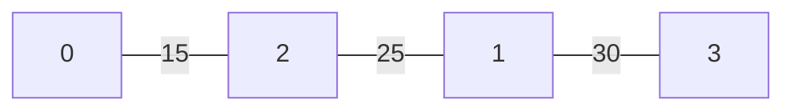

# Graph and backbone

[← Documentation home](README.md)

Covers [`edge.rs`](../src/edge.rs) and [`tree.rs`](../src/tree.rs). For the theory behind this page, see [Theory](theory.md).

## The problem

From the brainstorm: *given N generated rooms, how do I decide which rooms should be connected by doors?*

Requirements for the answer:

- every room has to be reachable from the starting room,
- not every room should connect to every other room,
- the result should be different per seed but the same for the same seed.

## The dungeon as a graph

| Graph term | In the dungeon |
|---|---|
| vertex | a room (identified by its `id`) |
| edge | a possible door between two rooms |
| weight | a random cost on each edge |
| spanning tree | the backbone: the edges that actually become doors |

## `Edge` ([`edge.rs` L6–11](../src/edge.rs#L6-L11))

| Field | Meaning |
|---|---|
| `weight` | random cost, used by Prim to choose edges |
| `Ivertex1`, `Ivertex2` | ids of the two rooms; the edge is **undirected**, so the order doesn't matter |

`#[derive(Debug, Clone)]`: `Clone` lets `build_tree` copy chosen edges into the tree ([`tree.rs` L25](../src/tree.rs#L25)) without taking them out of the original list.

This representation is an **edge list** (edge set). See [Theory → Representations](theory.md#graph-representations) for why the final graph will be an adjacency list.

## `generate_edges(rng, rooms) -> Vec<Edge>` ([`edge.rs` L12–25](../src/edge.rs#L12-L25))

Creates one edge for every pair of rooms: a **complete graph**.

```
for i in 0..n
    for j in i+1..n
        push Edge { weight: random 1..=100, i, j }
```

- `j` starts at `i + 1` ([L15](../src/edge.rs#L15)), so there are no self-loops (`i–i`) and no duplicates (`i–j` and `j–i`). That means the "remove loops and parallel edges" step from the Prim/Kruskal notes is never needed here.
- The weight is random ([L17](../src/edge.rs#L17)) and comes from the seeded RNG.
- Number of edges: `n · (n − 1) / 2`.

| Rooms | Edges |
|---|---|
| 8 | 28 |
| 12 | 66 |
| 20 | 190 |

Every pair is a candidate because rooms are separate screens: any two rooms *could* be connected by a door. Which ones actually get a door is decided by the spanning tree. See [Design decisions](design-decisions.md#candidate-edges-and-weights) for why weights are random instead of based on distance.

## `build_tree(edges, rooms) -> Vec<Edge>`: Prim's algorithm ([`tree.rs` L4–29](../src/tree.rs#L4-L29))

### What it produces

A **spanning tree**:

- reaches every room (connected),
- has no cycles,
- has exactly `n − 1` edges,
- gives exactly one path between any two rooms.

This answers two brainstorm questions at once:

- *Every room has to be reachable?* A spanning tree is connected by definition.
- *How do you stop every room connecting to every other room?* A tree only keeps `n − 1` of the `n · (n − 1) / 2` candidate edges.

Because Prim always takes the cheapest valid edge, it's a **minimum** spanning tree for these weights. Since the weights are random, the result is effectively a random spanning tree that is fixed by the seed.

### How the code works

| Step | Code |
|---|---|
| `visited = [false; n]`, mark room 0 visited | [L5–6](../src/tree.rs#L5-L6) |
| repeat until the tree has `n − 1` edges | [L9](../src/tree.rs#L9) |
| reset "best so far" (`index_edges = 0`, `weight = 101`) | [L10–11](../src/tree.rs#L10-L11) |
| scan **all** edges | [L12](../src/tree.rs#L12) |
| keep it only if exactly one end is visited (XOR) | [L13](../src/tree.rs#L13) |
| keep it only if cheaper than the best so far | [L14–17](../src/tree.rs#L14-L17) |
| mark both ends of the best edge visited | [L20–24](../src/tree.rs#L20-L24) |
| add the best edge to the tree | [L25](../src/tree.rs#L25) |

### Why XOR?

`visited[a] ^ visited[b]` is `true` only when exactly one end is visited:

| `visited[a]` | `visited[b]` | XOR | Meaning |
|---|---|---|---|
| false | false | false | neither room is in the tree yet, skip |
| true | false | **true** | connects the tree to a new room ✔ |
| false | true | **true** | connects the tree to a new room ✔ |
| true | true | false | both already in the tree; would make a cycle, skip |

This is what makes it Prim: every round looks at edges from **all** visited rooms, not only the room that was added last. It also means no separate cycle check is needed: an edge between two visited rooms is simply never a candidate.

### Tie-breaking

The comparison is `edge.weight < weight` (strictly less, [L14](../src/tree.rs#L14)), so with equal weights the **first edge in `Vec` order** wins. That is deterministic, because the edge `Vec` is always built in the same order.

The brainstorm chose to break ties *via the seed*. In practice the weights themselves already come from the seed, so the tree is still seed-driven; the only fixed part is which of two equal-weight edges wins. See [Design decisions → Ties](design-decisions.md#tie-breaking).

### Worked example

4 rooms, 6 edges:

| Edge | Weight |
|---|---|
| 0–1 | 40 |
| 0–2 | 15 |
| 0–3 | 70 |
| 1–2 | 25 |
| 1–3 | 30 |
| 2–3 | 90 |

| Round | Visited | Crossing edges (exactly one end visited) | Picked |
|---|---|---|---|
| 1 | {0} | 0–1 40, 0–2 15, 0–3 70 | **0–2 (15)** |
| 2 | {0, 2} | 0–1 40, 0–3 70, 1–2 25, 2–3 90 | **1–2 (25)** |
| 3 | {0, 1, 2} | 0–3 70, 1–3 30, 2–3 90 | **1–3 (30)** |

Result: `0–2, 1–2, 1–3` (3 edges = n − 1, total weight 70).



### Cost

Each of the `n − 1` rounds scans all `E` edges: O(n · E). On a complete graph `E ≈ n²/2`, so O(n³). At 20 rooms that's about 3600 checks. A priority-queue (binary heap) version would only matter for much bigger graphs, and optimisation is out of scope for now.

## What comes after the tree

The tree is currently a flat `Vec<Edge>`. Planned next steps (see [Roadmap](roadmap.md)):

1. turn it into an **adjacency list**,
2. **BFS** from the start room to find the end room (the room with the most doors between it and the start),
3. **validate the backbone**,
4. derive the **door wall** for every edge from the two rooms' relative positions.
