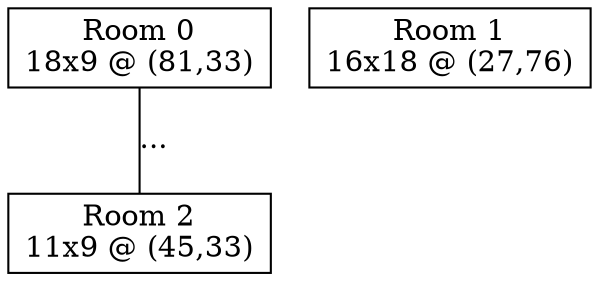

# Visualisation

[← Documentation home](README.md)

Covers [`grid.rs`](../src/grid.rs) and [`tree_visualization.rs`](../src/tree_visualization.rs). Both are debugging tools only; the game doesn't use them. They exist so generation can be checked by eye without Godot.

## ASCII grid ([`grid.rs`](../src/grid.rs))

[`Grid`](../src/grid.rs#L6-L10):

| Field | Meaning |
|---|---|
| `width`, `height` | grid size in tiles |
| `chars` | `Vec<Vec<char>>`, indexed `chars[y][x]` (row first) |

| Function | What it does | Code |
|---|---|---|
| `Grid::constructor(width, height)` | makes a grid filled with `.` | [L13–20](../src/grid.rs#L13-L20) |
| `grid.draw_room(&room)` | fills the room's tiles with its id symbol | [L22–32](../src/grid.rs#L22-L32) |
| `print_grid(&grid)` | prints one line per row | [L35–40](../src/grid.rs#L35-L40) |

Used in [`main.rs` L83–89](../src/main.rs#L83-L89).

### Room symbols

The id is written in base 36 with `char::from_digit(id % 36, 36)` ([L23](../src/grid.rs#L23)):

| id | Symbol |
|---|---|
| 0–9 | `0`–`9` |
| 10–35 | `a`–`z` |
| 36+ | wraps back to `0` |

With `max_room_count = 20` the highest symbol is `j`, so every room has a unique symbol.

`draw_room` skips tiles outside the grid ([L27](../src/grid.rs#L27)), so a bad room can't make it panic.

### Reading it

- Two different symbols right next to each other = touching rooms (allowed).
- A room that looks cut off by another symbol would mean an overlap; validation should have caught that.
- Lots of `.` = room for more rooms; few `.` = generation is close to the limit of the map.

## Graphviz tree ([`tree_visualization.rs`](../src/tree_visualization.rs))

### `visualize_tree_in_graph_form(tree, rooms)` ([L5–53](../src/tree_visualization.rs#L5-L53))

| Step | What happens | Code |
|---|---|---|
| 1 | start an undirected Graphviz `graph` with box-shaped nodes | [L6](../src/tree_visualization.rs#L6) |
| 2 | one node per room, labelled `Room id`, `width x height` and `@ (x, y)` | [L8–13](../src/tree_visualization.rs#L8-L13) |
| 3 | one line per tree edge, labelled with its weight | [L15–20](../src/tree_visualization.rs#L15-L20) |
| 4 | write `tree.dot` | [L24](../src/tree_visualization.rs#L24) |
| 5 | run `dot -Tpng tree.dot -o tree.png` | [L26–35](../src/tree_visualization.rs#L26-L35) |
| 6 | show the PNG in the terminal | [L39–52](../src/tree_visualization.rs#L39-L52) |

Terminal preview:

- **Kitty** (and not inside Vim/Neovim): `kitty +kitten icat tree.png`, a real image.
- **Otherwise**: `chafa --format symbols tree.png`, drawn with text characters. Real images don't work inside a (Neo)Vim terminal, so it uses `chafa` there.

Every step that can fail (missing `dot`, missing `chafa`) prints a message instead of crashing.

Example `tree.dot` (seed `42`, shortened):

### Checking the tree by eye

- Count the edges: should be rooms − 1.
- Every room box should have at least one line.
- There should be no loops.
- One room should be reachable from every other room by following lines.

Files are written to the **current working directory**, so running from another folder puts them there.
